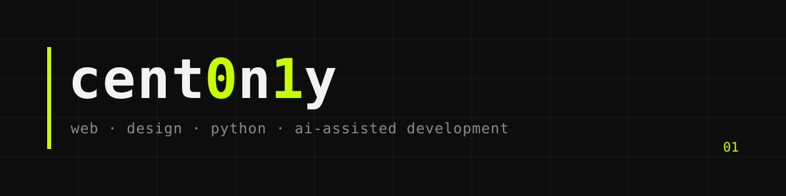

### Привет, это `cent0n1y`

Делаю сайты, которые выглядят дорого и работают просто. Совмещаю дизайн, код и управление проектом: от арт-направления и структуры до запуска. Пишу код в паре с ИИ и отвечаю за результат целиком.

```text
now      → сайты на Tilda с собственным кодом для заведения, премии, медиа и фестиваля
base     → Python, анализ данных, нейросети на PyTorch, сетевое программирование
design   → айдентика, постеры, презентации, UI-концепты, AI-визуалы
```

## Проекты

| | Репозиторий | О чём |
|---|---|---|
| 🌐 | **[client-websites](https://github.com/cent0n1y/client-websites)** | Четыре живых сайта: кейсы, скриншоты, подход к коду |
| 🧠 | **[python-data-ml](https://github.com/cent0n1y/python-data-ml)** | PyTorch с нуля и CNN, Numba, multiprocessing, Dask, SQL, фрактальные графы |
| 🔌 | **[python-networking](https://github.com/cent0n1y/python-networking)** | Сокеты и asyncio: echo-сервер с авторизацией, асинхронный сервер, сканер портов, тесты и CI |
| 📱 | **[mobile-apps](https://github.com/cent0n1y/mobile-apps)** | Прототипы на React Native (Expo) и Flutter |
| 🎨 | **[graphic-design](https://github.com/cent0n1y/graphic-design)** | Айдентика, постеры, стикеры, питч-дек, UI и AI-визуалы |
| 🧱 | **[web-fundamentals](https://github.com/cent0n1y/web-fundamentals)** | Первые проекты на HTML, JS и React · [демо](https://cent0n1y.github.io/web-fundamentals/) |

## Стек

**Web** &nbsp;


**Python · Data** &nbsp;


**Mobile** &nbsp;


**Design · AI** &nbsp;


---

<sub>design by 01</sub>
