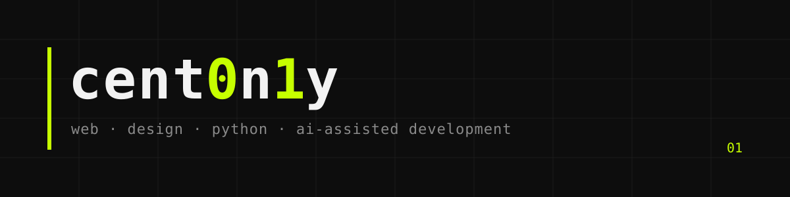

### Веб-дизайнер · сайты на Tilda с собственным кодом · AI-assisted

Делаю сайты, которые выглядят дорого и работают просто. Совмещаю дизайн, код и управление проектом: от арт-направления и структуры до запуска. Пишу код в паре с ИИ и отвечаю за результат целиком.

> 🟢 **Открыт к удалённой работе:** веб-дизайнер / Tilda, AI-дизайн и креативы, вайбкодинг.
>
> [](https://t.me/N31GHBOUR) [](mailto:zefnfingazz@gmail.com)

```text
now      → 7 живых сайтов на Tilda: заведение, премия, медиа, три фестиваля, страница романа
scale    → фестивали на 10 000+ и 2 000+ гостей, заведение в историческом центре Суздаля
base     → Python, анализ данных, нейросети на PyTorch, сетевое программирование
design   → айдентика, постеры, презентации, UI-концепты, AI-визуалы
```

## Избранные сайты

<table>
  <tr>
    <td width="33%" valign="top"><a href="https://kpsuzdal.ru"></a><br><b>Клуб Путешественников</b><br><sub>заведение в Суздале · <a href="https://kpsuzdal.ru">kpsuzdal.ru</a></sub></td>
    <td width="33%" valign="top"><a href="https://motograph.ru"></a><br><b>МОТОГРАФ</b><br><sub>кинофестиваль · <a href="https://motograph.ru">motograph.ru</a></sub></td>
    <td width="33%" valign="top"><a href="https://hookahcigars.ru"></a><br><b>Hookah Cigars</b><br><sub>медиа-портал · <a href="https://hookahcigars.ru">hookahcigars.ru</a></sub></td>
  </tr>
</table>

<sub>Ещё 4 сайта, мобильные версии и как я работаю с AI — в <a href="https://github.com/cent0n1y/client-websites">client-websites</a></sub>

## Проекты

| | Репозиторий | О чём |
|---|---|---|
| 🌐 | **[client-websites](https://github.com/cent0n1y/client-websites)** | Семь живых сайтов: кейсы, мобильные версии, работа с AI |
| 🧠 | **[python-data-ml](https://github.com/cent0n1y/python-data-ml)** | PyTorch с нуля и CNN, Numba, multiprocessing, Dask, SQL, фрактальные графы |
| 🔌 | **[python-networking](https://github.com/cent0n1y/python-networking)** | Сокеты и asyncio: echo-сервер с авторизацией, асинхронный сервер, сканер портов, тесты и CI |
| 📱 | **[mobile-apps](https://github.com/cent0n1y/mobile-apps)** | Прототипы на React Native (Expo) и Flutter |
| 🎨 | **[graphic-design](https://github.com/cent0n1y/graphic-design)** | Айдентика, постеры, стикеры, питч-дек, UI и AI-визуалы |
| 🧱 | **[web-fundamentals](https://github.com/cent0n1y/web-fundamentals)** | Первые проекты на HTML, JS и React · [демо](https://cent0n1y.github.io/web-fundamentals/) |

## Стек

**Web** &nbsp;


**Python · Data** &nbsp;


**Mobile** &nbsp;


**Design · AI** &nbsp;


---

**Связаться:** [Telegram @N31GHBOUR](https://t.me/N31GHBOUR) · [zefnfingazz@gmail.com](mailto:zefnfingazz@gmail.com)

<sub>design by 01</sub>
